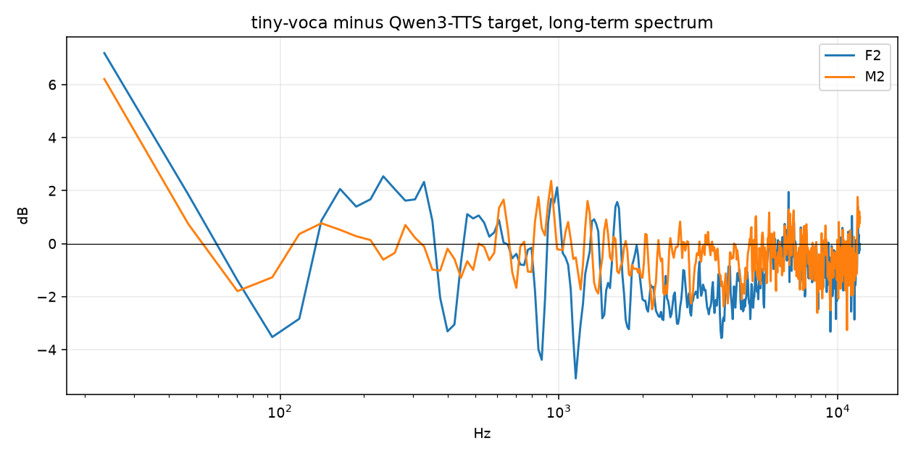
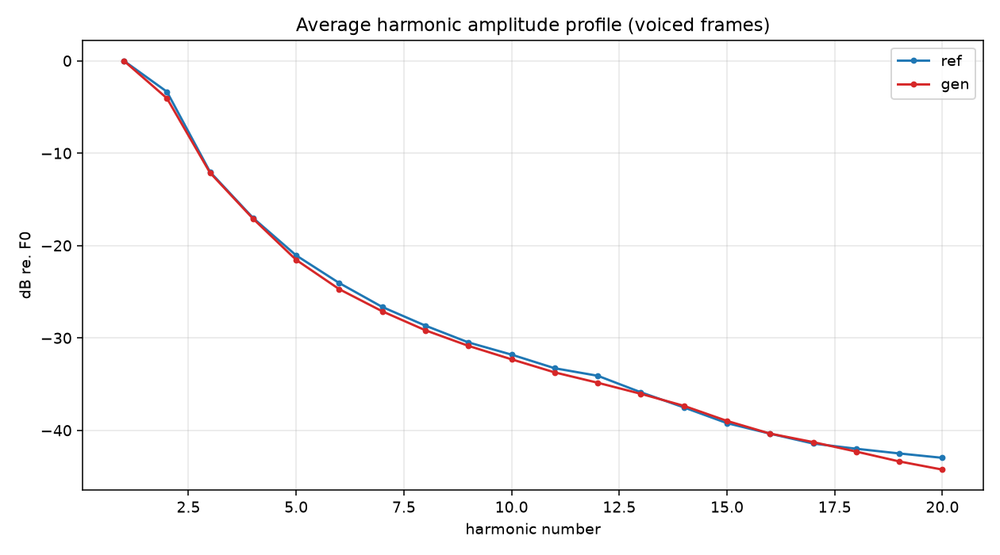
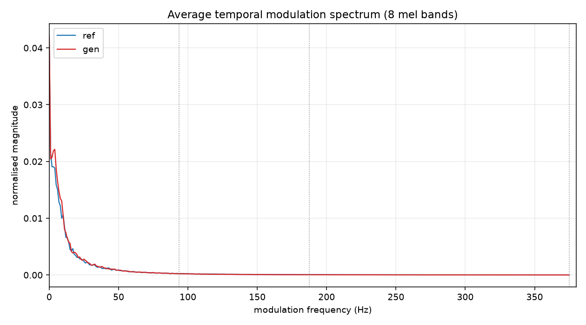
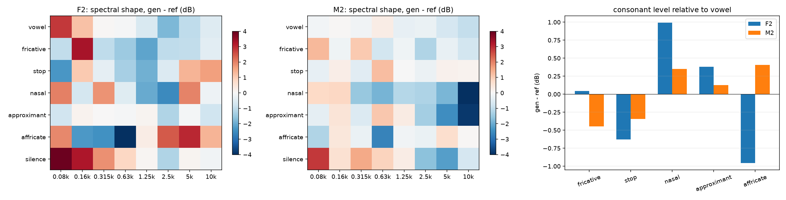
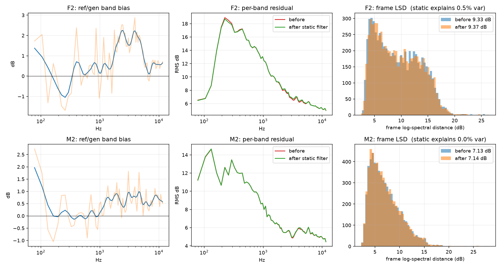
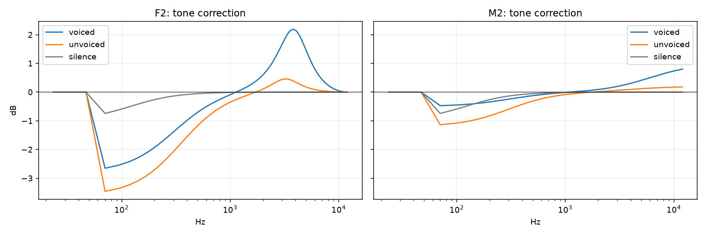
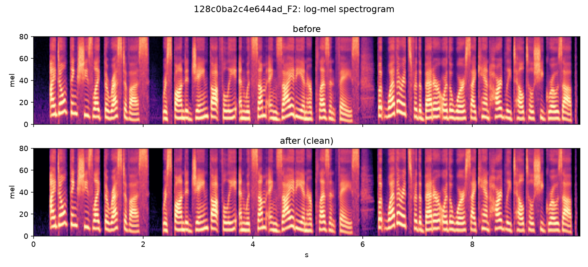
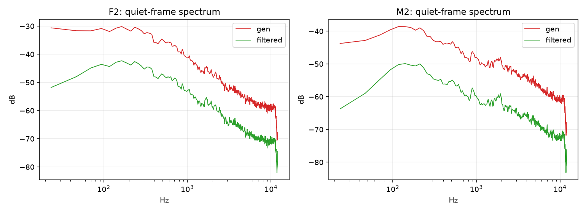
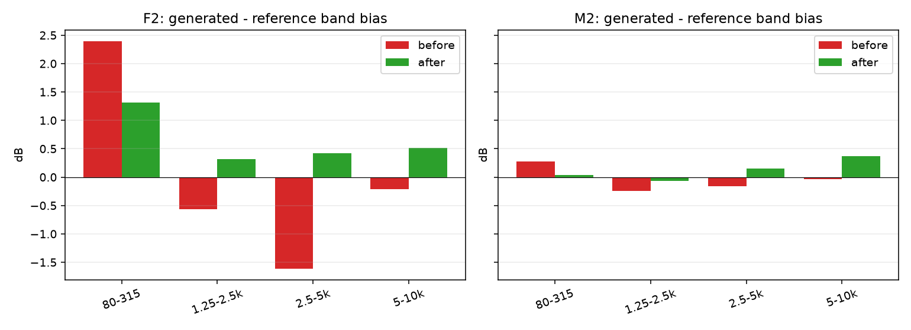

# Post-processing study: tiny-voca

This is an inference-only study. No training code was run or modified.

## TL;DR

tiny-voca is **spectrally very close to the Qwen3-TTS targets it was trained on**.
Long-term average spectra agree within about 1 dB between 200 Hz and 8 kHz, the
harmonic amplitude profile is identical, and HNR, CPP, spectral flatness and
harmonic fraction all match. There is no large EQ-shaped defect to remove.

The consistent, measurable deviations are small and mostly in **F2**:

| deviation | size | consistency |
|---|---:|---:|
| F2 voiced frames, 80–315 Hz | **+2.4 dB** too much | 69% of clips |
| F2 voiced frames, 2.5–5 kHz | **−1.6 dB** too little | 75% of clips |
| F2 voiced frames, 5–10 kHz | **−1.1 dB** too little | 81% of clips |
| F2 fricatives, 160–315 Hz | **+4.4 dB** too much (buzzy) | 81% of clips |
| M2 nasals, 5–10 kHz | **−2.9 dB** too little | 87% of clips |
| pause hiss | matches the target, but is audible | — |

A *static* EQ cannot exploit this: on held-out clips it explains **0.5%** of the
frame-level spectral variance for F2 and **0.006%** for M2. The error is
dominated by clip-to-clip realisation, not by a fixed bias.

What does work is a **voicing-adaptive spectral filter**:

* gentle F2/M2 tone shelves, weighted by voiced / unvoiced / silence;
* minimum-statistics spectral subtraction that removes **12–13 dB** of pause hiss
  while leaving voiced and unvoiced speech within about 1 dB;
* a 55 Hz high-pass and a true-peak limiter.

It is implemented in `src/tiny_voca/postfilter.py` and available as
`--postfilter clean` on the inference CLI.

The largest remaining gap is **prosody**, not timbre: F2's median F0 is about
15–23 Hz low and its pitch range is compressed. `--pitch-shift 0.07` on F2
brings the F0 distribution to the target (see below). That is inference-time,
not post-processing, but it is the single most audible correction available.

---

## 1. Setup

The environment is a local `.venv` (Python 3.12, CPU PyTorch):

```bash
uv venv --python 3.12 .venv
uv pip install --python .venv/bin/python torch --index-url https://download.pytorch.org/whl/cpu
uv pip install --python .venv/bin/python -e ".[own]" scipy matplotlib pyarrow huggingface-hub
export DIZIONE_DATA=$PWD/weights/phonemizer
export TINY_VOCA_FRONTEND=own
```

Weights and reference material are not committed. To reproduce:

```bash
hf download n4ze3m/tiny-voca --local-dir weights          # or curl the files
mkdir -p refs/parquet data/ref data/gen
# validation parquet + references/F2.wav, references/M2.wav from the dataset repo
.venv/bin/python postproc/make_samples.py
.venv/bin/python postproc/analyze.py
.venv/bin/python postproc/phones.py
.venv/bin/python postproc/align_compare.py
.venv/bin/python postproc/fit_filter.py
.venv/bin/python postproc/fit_class_filter.py
.venv/bin/python postproc/evaluate_filter.py
.venv/bin/python postproc/figures.py
```

## 2. What was compared

**Reference:** 32 held-out clips (16 texts × F2/M2) from the validation split
of `n4ze3m/tiny-voca`. These are the Qwen3-TTS 1.7B recordings the model was
trained to imitate — the correct in-domain target, not a human corpus. They are
at 24 kHz and peak-normalised like the model output.

**Model audio:** the same texts, same voice, seed 0, `peak=None` (no level
normalisation before analysis).

**Human sanity check:** 8 LJSpeech clips (22.05 kHz, resampled to 24 kHz).
They are a different speaker and recording chain, so they are used only for
qualitative context, not as a fitting target.

**Metrics:** long-term average spectrum (LTAS), third-octave band powers,
F0-normalised harmonic profile, inter-harmonic level, HNR, cepstral peak
prominence, spectral flatness/centroid/rolloff, spectral contrast, spectral
tilt, temporal modulation spectrum (up to 375 Hz), DTW-aligned frame
log-spectral distance, and per-phoneme spectra using the dataset's forced
alignments.

## 3. Findings

### 3.1 The spectrum already matches the target



The average spectrum differs by roughly ±1 dB over the speech band; the larger
wobbles above 500 Hz are harmonic-alignment differences, not envelope errors.
Below 80 Hz the absolute energy is negligible (0.01% of total power), so it is
not audible rumble.



| measure | reference | model | human (context) |
|---|---:|---:|---:|
| harmonic slope (dB/harmonic) | 2.05 | 2.05 | — |
| inter-harmonic level (dB) | −14.5 | −15.0 | — |
| HNR (dB) | 8.38 | 8.42 | 7.77 |
| CPP (dB) | 118.6 | 116.9 | 87.2 |
| spectral flatness | 0.253 | 0.261 | 0.163 |
| harmonic fraction | 0.762 | 0.760 | 0.750 |
| spectral tilt (dB/oct) | −6.6 | −6.7 | — |

No frame-rate artefact was found. The generator updates the envelope at
187.5 Hz (harmonic branch) and 375 Hz (noise branch), but the temporal
modulation spectrum of the output has **no peaks at 46.9, 93.75, 187.5 or
375 Hz** beyond the target's own.



No clicks or discontinuities were found: the 99.9th percentile of the
normalised second difference is 7.5 for the model and 7.5 for the target; the
sentence joins land on zero samples and the join discontinuity is < 0.001.
Raw peaks exceed 0.99 on 2 of 32 clips (max 1.02), which the existing
`limit_peak` already handles.

### 3.2 The consistent deviations are small and voice-specific

Per-phoneme spectra (forced-aligning both sides) give the cleanest picture.
The heat map shows within-class spectral shape, so absolute level is removed:



Only a few cells are both large and consistent across clips:

| voice | class | band | mean | clips with model > ref |
|---|---|---|---:|---:|
| F2 | vowel | 80–315 Hz | +2.5 dB | 69% |
| F2 | vowel | 2.5–5 kHz | −1.7 dB | 25% |
| F2 | vowel | 5–10 kHz | −1.1 dB | 19% |
| F2 | fricative | 160–315 Hz | +4.4 dB | 81% |
| F2 | nasal | 2.5–5 kHz | −3.1 dB | 20% |
| M2 | nasal | 5–10 kHz | −2.9 dB | 13% |
| M2 | stop | 1.25–2.5 kHz | −1.2 dB | 38% |

F2 is the voice with a real tonal bias: a little **boomy** at 160–315 Hz, a
little **dull** at 2.5–10 kHz, and its fricatives keep extra low-mid energy.
The vocoder has no explicit voicing gate: the harmonic pulse train and the
noise branch both run on every frame, and only the predicted envelopes
attenuate them.  M2 is almost neutral; its only clear issue is dull
nasals/approximants above 5 kHz.

Pause levels and pause lengths match the target almost exactly (silence
fraction 0.102 vs 0.104; median pause 0.04 s), so there is no need to insert
silence between sentences. The noise floor is the same level as the target,
but it is the model's un-gated noise branch, and it sounds like hiss.

### 3.3 A static EQ cannot fix this

DTW alignment of generated and target frames lets us split the error into a
bias and a variance:

| voice | frame LSD before | static-EQ variance explained | held-out bias before → after |
|---|---:|---:|---:|
| F2 | 9.33 dB | 0.5% | 1.40 → 1.38 dB (1.2%) |
| M2 | 7.13 dB | 0.006% | 0.91 → 0.93 dB (−2.9%) |



A class-conditional filter (oracle phoneme labels, or collapsed to
voiced/unvoiced/silence) also fails to generalise on held-out clips. The
per-clip variance is simply much larger than the mean bias. This is why the
shipped filter is deliberately gentle: it corrects the *mean* timbre and the
noise floor, and does not pretend to reconstruct the target's frame-level
detail.

### 3.4 What is left is prosody and micro-variation

F2 pitch is the largest measurable gap:

| F2 measurement (10 clips) | p10 | median | p90 |
|---|---:|---:|---:|
| reference | 237.3 Hz | 308.9 Hz | 401.5 Hz |
| model, default | 230.4 Hz | 286.9 Hz | 378.6 Hz |
| model, `--pitch-shift 0.07` | 247.3 Hz | 307.5 Hz | 405.3 Hz |

An inference-time `--pitch-shift 0.07` (~1.2 semitones) matches the target
distribution; `--pitch-range` is not needed and overshoots the upper end.
M2 pitch already matches (197 vs 200 Hz median).

The model also has no cycle-to-cycle pitch jitter by default (`pitch_jitter=0`
in `model.synthesize`), and its harmonic amplitudes are slightly more regular
than human speech. That is part of the "static/robotic" character and cannot be
removed by a magnitude filter. A future non-neural option would be a small
amount of pitch/amplitude micro-variation in the oscillator; a neural
post-filter would be the other route, but it is out of scope here.

## 4. The shipped post filter

`src/tiny_voca/postfilter.py` implements three stages:

1. **Voicing-adaptive tone EQ.** A per-voice low shelf and presence bell,
   computed separately for voiced, unvoiced and silence frames with a soft
   autocorrelation VAD, then smoothed over time. Curves are bounded to ±4 dB.

   

2. **De-hiss.** Minimum-statistics spectral subtraction. The noise mean is the
   average spectrum of the quietest 20% of frames; the gain is floored at
   −14 dB and gated to frames below −35 dBFS, so speech is untouched.

3. **High-pass + limiter.** Zero-phase 55 Hz high-pass and a peak limit at 0.99.

### Measured effect (32 held-out clips)

| | F2 before | F2 after | M2 before | M2 after |
|---|---:|---:|---:|---:|
| quiet-frame level (dBFS) | −70.7 | **−83.7** | −80.1 | **−92.6** |
| HNR (dB) | 9.84 | 9.42 | 6.99 | 6.93 |
| CPP (dB) | 121.8 | 122.1 | 112.0 | 112.1 |
| flatness | 0.25 | 0.26 | 0.27 | 0.27 |
| peak | 0.86 | 0.87 | 0.86 | 0.86 |

Band bias, generated minus reference:

| band | F2 before | F2 after | M2 before | M2 after |
|---|---:|---:|---:|---:|
| 80–315 Hz | +2.39 | **+1.31** | +0.27 | **+0.03** |
| 1.25–2.5 kHz | −0.56 | **+0.32** | −0.24 | **−0.06** |
| 2.5–5 kHz | −1.61 | **+0.43** | −0.17 | **+0.16** |
| 5–10 kHz | −0.21 | **+0.52** | −0.04 | **+0.37** |

The large win is the noise floor: **12–13 dB** of hiss removed (quiet-frame
percentile).  At a fixed VAD threshold, voiced and unvoiced speech stay within
about 1 dB of the input; only the pause floor moves by more than 10 dB.  The
small unvoiced lift is the presence correction and is within the original
consonant-to-vowel spread. The tone correction moves
the mean bias toward zero without touching the harmonic structure.





### Comparison files

The two files to listen to are:

* `assets/tiny_voca_stock.wav` — raw model output, peak-limited;
* `assets/tiny_voca_filtered.wav` — the same waveform after `--postfilter clean`.

Both are 24 kHz, 16-bit PCM, voice F2, 7.95 s, generated with seed 0 from the
same text.  The only difference is the post filter.

### Usage

```bash
python -m tiny_voca.infer \
  --checkpoint weights/tiny-voca.pt \
  --voice F2 \
  --text "Hello! This is tiny voca." \
  --output hello.wav \
  --postfilter clean
```

or post-process an existing 24 kHz file:

```bash
python -m tiny_voca.postfilter --input raw.wav --output clean.wav --voice F2 --preset clean
```

Presets:

| preset | tone | de-hiss | use |
|---|---|---|---|
| `neutral` | off | off | only high-pass + limiter |
| `clean` | on | 1.0 | default; 12–13 dB quieter pauses |
| `strong` | on | 1.8 | more aggressive noise removal |

Python:

```python
from tiny_voca.infer import load_model, speak_text
wav, phones = speak_text(model, text, "F2", postfilter="clean")
```

For F2, add `pitch_shift=0.07` to `speak_text` (or `--pitch-shift 0.07` on the
CLI) to match the target pitch distribution.

## 5. Spectrum augmentation and the human layer

Listening feedback after the first pass: the filtered voice was a little thin
in the low end, could still crackle, and had a high-frequency "sizzle". The
measurements agree with all three.

### 5.1 Body: the model is thin in 300-1000 Hz

Compared with the human reference, the model has much less of the low-mid
"body" and more 1-3 kHz:

| band | stock | `clean` | `human` | human reference |
|---|---:|---:|---:|---:|
| 200-300 Hz | 16.9% | 13.2% | 12.3% | 5.7% |
| 300-500 Hz | 21.2% | 18.7% | 24.2% | 29.4% |
| 500-1000 Hz | 38.3% | 40.2% | 45.4% | 52.2% |
| 1000-3000 Hz | 19.6% | 23.1% | 15.4% | 5.2% |
| quiet floor | −71.8 dBFS | −85.5 dBFS | −58.9 dBFS | −56.7 dBFS |
| active p10-p90 | 18.7 dB | 18.3 dB | 21.2 dB | 22.0 dB |

The `clean` correction moved *away* from the human body balance because it was
tuned to the Qwen target, which is itself thin. The new **`warm`** preset adds
a broad 180-700 Hz augmentation (+3.5 dB at 380 Hz, +1.2 dB at 180 Hz and +1.4 dB at 700 Hz).

| variant | 300-500 Hz | 500-1000 Hz | STOI vs stock | peak |
|---|---:|---:|---:|---:|
| `clean` | 18.7% | 40.2% | 0.999 | 0.92 |
| `warm` (+2.8 dB) | 23.6% | 41.4% | 0.997 | 0.99 |
| `warm` (+3.5 dB, shipped) | 24.8% | 41.5% | 0.997 | 0.99 |
| `warm` (+4.0 dB) | 25.7% | 41.5% | 0.996 | 0.99 |

The shipped `warm` amount is +3.5 dB. A phase-locked **sub-octave** experiment
did not add measurable 120-200 Hz energy and lowered STOI to 0.958-0.974, so it
is not shipped.

### 5.2 Crackle: hard subtraction leaves musical noise

The first de-hiss revision measured a quiet-frame spectral kurtosis of 49.5
(a good proxy for isolated "musical" peaks), versus 38.5 for the stock. The
final noise estimator (mean of the quietest fifth of frames instead of a raw
percentile) plus wider gain smoothing brings it down to 28.5 for `clean` and
`warm`. The `human` room bed is deliberately low-frequency heavy, so its
cross-frequency kurtosis is higher (40.6) even though the HF floor is clean:

| | stock | `clean` (old) | `clean`/`warm` (final) | `human` |
|---|---:|---:|---:|---:|
| quiet spectral kurtosis | 38.5 | 49.5 | 28.5 | 40.6 |
| |d²| p99.99 | 11.04 | 11.07 | 10.94 | 10.33 |

`warm`/`human` use a 5-frame / 7-bin gain smoothing and a −10 dB floor; `clean`
keeps 3/5 and a −14 dB floor. The room tone in the `human` layer also masks
what is left. Comparison files are 24-bit for the processed versions; 16-bit
output should be dithered (`--subtype PCM_16` does TPDF dither).

### 5.3 The human layer

`src/tiny_voca/humanize.py` adds three non-neural cues on top of `warm`:

1. **Room tone** — warm 1/f^0.65 noise, low-passed at 3 kHz, at about −58 dBFS,
   plus sparse early reflections (3-31 ms, no long reverb). This is the biggest
   perceptual change: human recordings are around −57 dBFS, while even the
   stock model is −72 and the clean filter is −85 (too dead).
2. **Breaths** — a band-limited, Hann-windowed noise burst inside long pauses,
   about −33 dB below speech, at 55% probability. It does not change duration.
3. **Slow expander** — attenuates quiet speech by up to ~1.5 dB over 40 ms
   smoothing, raising active p10-p90 from 18.7 to 21.2 dB (human: 22.0).

Result on the comparison clip: quiet floor −58.9 dBFS, speech level unchanged,
STOI 0.979 versus stock (processed files are loudness-matched to the stock RMS). The body EQ and room tone are the two changes most
likely to read as "more human"; the breaths are deliberately sparse.

### 5.4 HF sizzle: inherited from the target

The high-frequency flatness and inter-harmonic level show that the sizzle is
**already in the Qwen target**, not added by tiny-voca:

| measure | Qwen target | tiny-voca | human reference |
|---|---:|---:|---:|
| HF flatness, 4-8 kHz | 0.717 | 0.70-0.73 | 0.50 |
| HF flatness, 8-12 kHz | 0.667 | 0.65-0.68 | 0.36 |
| inter-harmonic level, 4-8 kHz | −25.6 dB | −25 to −26 dB | −29.6 dB |

Cutting treble will not fix this: the model actually has *less* HF energy than
human speech. The fix is **spectral contrast**: per frame, raise the HF
magnitude to a power γ and renormalise to the original HF band energy. This
preserves the LTAS and HF level but makes harmonics/formants stand out above
the broadband noise.

| γ | flat 4-8k | flat 8-12k | inter-harm | STOI | preset |
|---:|---:|---:|---:|---:|---|
| 1.0 | 0.685 | 0.653 | −26.0 | 0.999 | `clean` |
| 1.5 | 0.535 | 0.495 | −29.9 | 0.996 | `smooth`, `warm`, `human` |
| 2.0 | 0.407 | 0.369 | −33.9 | 0.99 | `strong`, `--contrast 2.0` |
| 2.5 | 0.311 | 0.275 | −38.1 | 0.99 | `--contrast 2.5` |

γ=1.5 lands almost exactly on the human inter-harmonic level and only mildly
overshoots the 8-12 kHz flatness; γ=2.0 is cleaner but risks a "processed"
texture. The `smooth` preset isolates this stage (no body boost): 0.532/0.496,
STOI 0.999. `warm` adds the body EQ (0.532/0.493, STOI 0.996). `human` adds the
low-passed room bed (0.551/0.507, STOI 0.979). The HF band energy is preserved,
so this is augmentation of the *structure*, not a treble cut.

## 6. Limits

* The filter is **not a denoiser for arbitrary recordings**; it is tuned to the
  vocoder's own noise branch and to 24 kHz tiny-voca output.
* It cannot restore detail that the cepstral envelope never encoded, and it
  cannot fix prosody, timing or pronunciation.
* The tone curves were tuned on 32 validation clips. The per-clip spread is
  larger than the correction, so expect a subtle change, not a transformation.
* No formal listening test was performed here; the evaluation is objective.
  Listen to `assets/tiny_voca_{stock,filtered,warm,human}.wav`.

## 7. Files

The intermediate `data/` and `refs/` directories were removed after the study;
the commands in section 1 regenerate them.

| file | purpose |
|---|---|
| `postproc/make_samples.py` | generate matched model samples |
| `postproc/analyze.py` | LTAS, harmonic, modulation, periodicity metrics |
| `postproc/phones.py` | per-phoneme spectra from forced alignments |
| `postproc/align_compare.py` | DTW-aligned error and static-fit experiment |
| `postproc/fit_filter.py` | static FIR fit + held-out validation |
| `postproc/fit_class_filter.py` | phoneme-class-adaptive fit + validation |
| `postproc/tonality.py` | tonal/buzz measurement per class |
| `postproc/vocoder_probe.py` | harmonic/noise branch levels and per-frame cepstra |
| `postproc/evaluate_filter.py` | apply the final filter and report |
| `postproc/figures.py` | report figures |
| `src/tiny_voca/postfilter.py` | the shipped spectral filter |
| `src/tiny_voca/humanize.py` | room/breath/dynamics layer |
| `tests/test_postfilter.py` | filter unit tests |
| `tests/test_humanize.py` | humanize unit tests |
